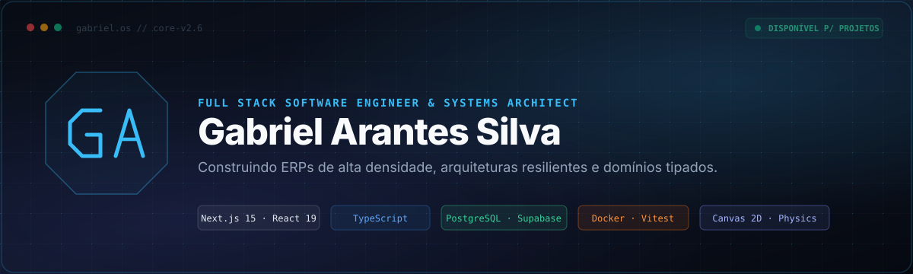

  

 

---

## 👨‍💻 About Me & Engineering Philosophy

**Full Stack Software Engineer & Systems Architect** based in **Formiga, Minas Gerais, Brazil**.

My engineering principles follow a straightforward axiom: **the best architecture is not the most complex one, but the one that solves the actual bottleneck with determinism, security, and observability from Day 1**.

I design and build high-density transactional corporate systems (accounting/tax ERPs, PWAs, and SaaS platforms), pairing **strictly typed domains** across the stack with rock-solid relational databases (**PostgreSQL / Supabase**), strict **Row Level Security (RLS)** policies, and responsive interfaces with advanced graphical rendering.

---

## ⚡ Featured Projects & Real-World Solutions

<table width="100%">
  <thead>
    <tr>
      <th width="28%">Project</th>
      <th width="42%">What It Is &amp; Problem Solved</th>
      <th width="30%">Stack &amp; Access</th>
    </tr>
  </thead>
  <tbody>
    <tr>
      <td>
        <strong>VORTEX OS</strong> 
        <em>Enterprise Accounting ERP</em>
      </td>
      <td>
        High-density web ERP custom-built for an accounting firm. Unifies <strong>Tax, Bookkeeping, and Payroll</strong> in the cloud. Features batch XML processing (NF-e/NFC-e/NFS-e), automated Simples Nacional calculation, Brazilian eSocial compliance (S-2200), OFX/CSV bank reconciliation, and a Client Portal with IP-stamped receipt audit trails.
      </td>
      <td>
        <code>Next.js 15</code> · <code>React 19</code> · <code>TypeScript</code> · <code>Supabase RLS</code> · <code>PostgreSQL</code>  
        🔗 <a href="https://vortex-os-pi.vercel.app/login"><strong>Live Demo (Login)</strong></a>
      </td>
    </tr>
    <tr>
      <td>
        <strong>gabriel.os</strong> 
        <em>Web Operating System</em>
      </td>
      <td>
        High-performance browser OS simulator. Resolves the tension between quick recruiter review (under 30s) and deep architectural exploration. Features router-less routing via <code>pushState</code>, <strong>HTML5 Canvas 2D</strong> spring physics particle engine, and static compilation of 330 notes from my <strong>Second Brain (Obsidian)</strong> into an interactive graph.
      </td>
      <td>
        <code>React 19</code> · <code>Vite</code> · <code>Tailwind 4</code> · <code>Canvas 2D</code> · <code>Vitest</code>  
        🔗 <a href="https://gabrielarantessilva.com"><strong>gabrielarantessilva.com</strong></a> 
        📦 <a href="https://github.com/GabrielArantesSilva/my-portfolio"><strong>Source Code</strong></a>
      </td>
    </tr>
    <tr>
      <td>
        <strong>Enemza</strong> 
        <em>Exam Prep PWA</em>
      </td>
      <td>
        Progressive Web App for Brazil’s National Exam (ENEM). Eliminates the anxiety of toxic public rankings by prioritizing personal XP growth. Features an offline data pipeline fusing official INEP exams with LLM-generated questions (with mandatory double-check validation), Markdown note-taking, and in-house auth via <code>scrypt</code> and HMAC cookies.
      </td>
      <td>
        <code>Next.js 15</code> · <code>Prisma</code> · <code>Neon Postgres</code> · <code>PWA</code> · <code>Gemini AI</code>  
        📦 <a href="https://github.com/GabrielArantesSilva/EnemzaMVP"><strong>GitHub Repository</strong></a>
      </td>
    </tr>
    <tr>
      <td>
        <strong>Dobra SaaS</strong> 
        <em>Body Composition Assessment</em>
      </td>
      <td>
        Clinical software for nutritionists and doctors to calculate body fat from skinfold measurements (Jackson/Pollock and Durnin/Womersley). Replaces broken spreadsheets with a mathematically typed, tested domain. Warns against non-peer-reviewed formulas and ensures HIPAA/LGPD medical data isolation via Supabase RLS.
      </td>
      <td>
        <code>TanStack Start</code> · <code>React 19</code> · <code>Supabase</code> · <code>Tailwind 4</code> · <code>Vitest</code>  
        📦 <a href="https://github.com/GabrielArantesSilva/Dobra-SaaS"><strong>GitHub Repository</strong></a>
      </td>
    </tr>
    <tr>
      <td>
        <strong>Sales Bot Pix</strong> 
        <em>Telegram Sales &amp; Checkout Bot</em>
      </td>
      <td>
        Transactional bot for Telegram with instant Pix checkout, order tracking, and inventory control. Fully containerized with Docker and covered by unit/integration tests in Vitest.
      </td>
      <td>
        <code>Fastify</code> · <code>grammY</code> · <code>Prisma</code> · <code>PostgreSQL</code> · <code>Docker</code>  
        📦 <a href="https://github.com/GabrielArantesSilva/bot"><strong>GitHub Repository</strong></a>
      </td>
    </tr>
  </tbody>
</table>

---

## 🛠️ Tech Stack & Tooling

### Languages & Core

  

### Backend, Frameworks & Databases

  

### Frontend, Mobile & UI

  

### Infrastructure, DevOps & Testing

---

## 📊 Development Metrics

  
  

  

---

## 🐍 Contribution History

  

---

## 📬 Let's Connect

