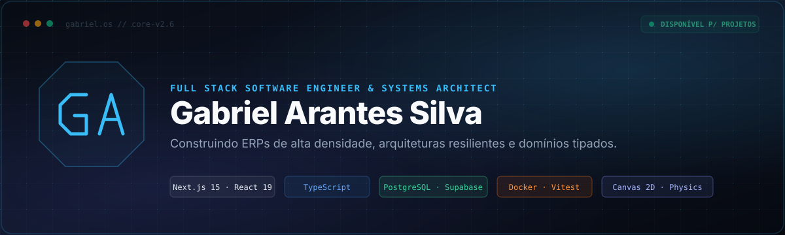

 

---

## 👨‍💻 Sobre Mim & Filosofia de Engenharia

Engenheiro de Software **Full Stack & System Architect** baseado em **Formiga, Minas Gerais**.

Minha atuação é pautada por uma regra simples: **a melhor arquitetura não é a mais complexa, mas a que resolve o gargalo real com determinismo, segurança e observabilidade desde o dia 1**.

Construo sistemas corporativos de alta densidade transacional (ERPs fiscais/contábeis, PWAs e plataformas SaaS), combinando **domínios estritamente tipados** no front-end e back-end, bancos relacionais robustos (**PostgreSQL / Supabase**) com políticas rígidas de **Row Level Security (RLS)** e interfaces responsivas com renderização gráfica avançada.

---

## ⚡ Projetos em Destaque & Soluções Reais

<table width="100%">
  <thead>
    <tr>
      <th width="28%">Projeto</th>
      <th width="42%">O que é &amp; O que Soluciona</th>
      <th width="30%">Stack &amp; Acesso</th>
    </tr>
  </thead>
  <tbody>
    <tr>
      <td>
        <strong>VORTEX OS</strong> 
        <em>ERP Contábil Corporativo</em>
      </td>
      <td>
        ERP web de alta densidade desenvolvido para escritório contábil. Unifica os módulos <strong>Fiscal, Contábil e Folha de Pagamento</strong> em nuvem. Possui parser automatizado de lotes de XML (NF-e/NFC-e/NFS-e), apuração do Simples Nacional por Anexo, eSocial (S-2200), conciliação bancária OFX/CSV e Portal do Cliente com protocolos de entrega carimbados por IP.
      </td>
      <td>
        <code>Next.js 15</code> · <code>React 19</code> · <code>TypeScript</code> · <code>Supabase RLS</code> · <code>PostgreSQL</code>  
        🔗 <a href="https://vortex-os-pi.vercel.app/login"><strong>Ver no ar (Login)</strong></a>
      </td>
    </tr>
    <tr>
      <td>
        <strong>gabriel.os</strong> 
        <em>Web Operating System</em>
      </td>
      <td>
        Simulador de Sistema Operacional de alta performance rodando no navegador. Resolve a tensão entre portfólio rápido (30s) e exploração profunda. Inclui roteamento sem router via <code>pushState</code>, simulação física de partículas em <strong>Canvas 2D</strong> com física de molas, e compilação estática de 330 notas do meu <strong>Segundo Cérebro (Obsidian)</strong> em um grafo interativo.
      </td>
      <td>
        <code>React 19</code> · <code>Vite</code> · <code>Tailwind 4</code> · <code>Canvas 2D</code> · <code>Vitest</code>  
        🔗 <a href="https://gabrielarantessilva.com"><strong>gabrielarantessilva.com</strong></a> 
        📦 <a href="https://github.com/GabrielArantesSilva/my-portfolio"><strong>Código-fonte</strong></a>
      </td>
    </tr>
    <tr>
      <td>
        <strong>Enemza</strong> 
        <em>PWA de Preparação para o ENEM</em>
      </td>
      <td>
        Plataforma educacional progressiva (PWA). Elimina a ansiedade de rankings tóxicos ao focar em evolução pessoal por XP. Possui pipeline de dados que combina o banco oficial do INEP com questões geradas por LLM (com dupla validação obrigatória), anotações em Markdown e autenticação própria segura com <code>scrypt</code> e cookies HMAC.
      </td>
      <td>
        <code>Next.js 15</code> · <code>Prisma</code> · <code>Neon Postgres</code> · <code>PWA</code> · <code>Gemini AI</code>  
        📦 <a href="https://github.com/GabrielArantesSilva/EnemzaMVP"><strong>Repositório GitHub</strong></a>
      </td>
    </tr>
    <tr>
      <td>
        <strong>Dobra SaaS</strong> 
        <em>Avaliação de Composição Corporal</em>
      </td>
      <td>
        Software clínico para nutricionistas e médicos calcularem percentual de gordura por dobras cutâneas (Jackson/Pollock e Durnin/Womersley). Substitui planilhas Excel quebradas por um domínio matemático rigorosamente tipado e testado. Alerta fórmulas sem evidência e garante segregação médica com Supabase RLS.
      </td>
      <td>
        <code>TanStack Start</code> · <code>React 19</code> · <code>Supabase</code> · <code>Tailwind 4</code> · <code>Vitest</code>  
        📦 <a href="https://github.com/GabrielArantesSilva/Dobra-SaaS"><strong>Repositório GitHub</strong></a>
      </td>
    </tr>
    <tr>
      <td>
        <strong>Sales Bot Pix</strong> 
        <em>Bot de Vendas &amp; Pagamentos</em>
      </td>
      <td>
        Bot transacional para Telegram com checkout instantâneo via Pix, controle de pedidos e estoque. Totalmente containerizado em Docker com suíte de testes unitários e de integração no Vitest.
      </td>
      <td>
        <code>Fastify</code> · <code>grammY</code> · <code>Prisma</code> · <code>PostgreSQL</code> · <code>Docker</code>  
        📦 <a href="https://github.com/GabrielArantesSilva/bot"><strong>Repositório GitHub</strong></a>
      </td>
    </tr>
  </tbody>
</table>

---

## 🛠️ Stack & Tecnologias

### Linguagens & Core

  

### Backend, Frameworks & Bancos de Dados

  

### Frontend, Mobile & UI

  

### Infraestrutura, DevOps & Testes

---

## 📊 Métricas de Desenvolvimento

  
  

  

---

## 🐍 Histórico de Contribuições

  

---

## 📬 Vamos Conversar?

